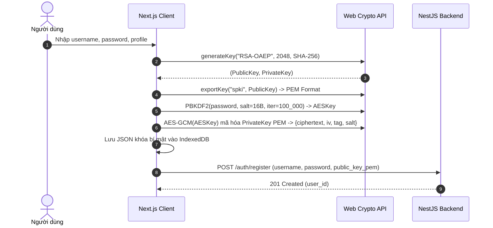
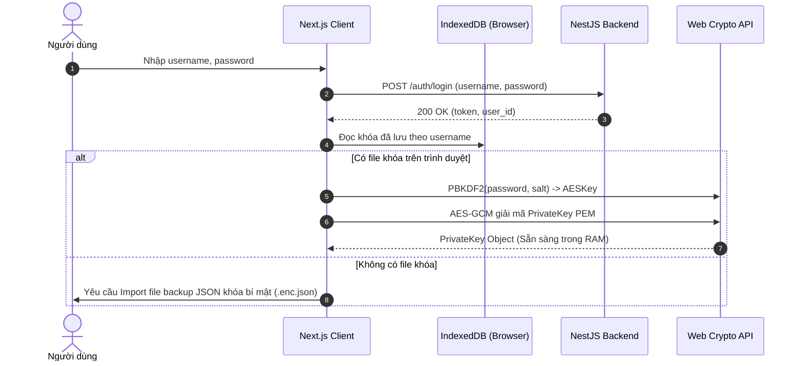
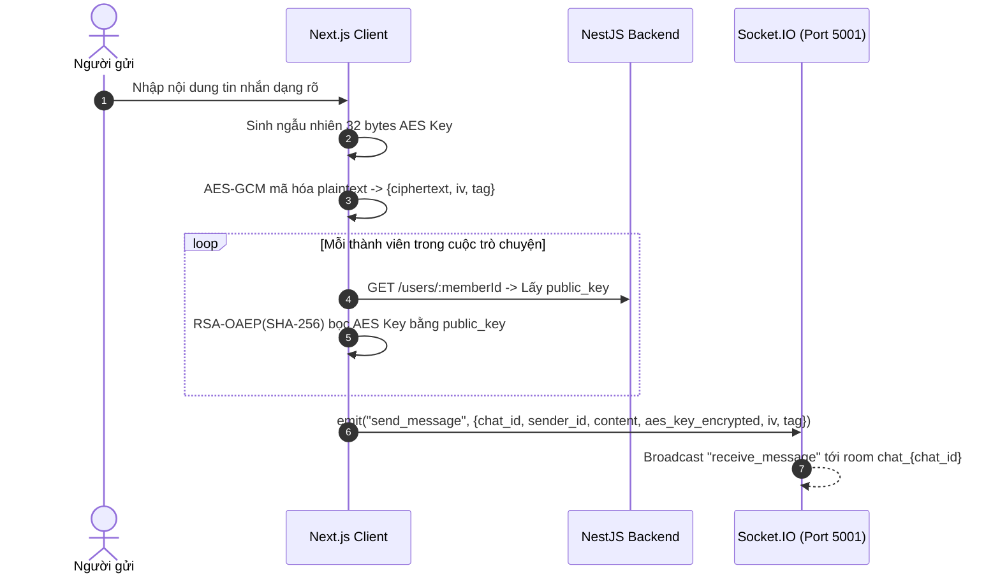
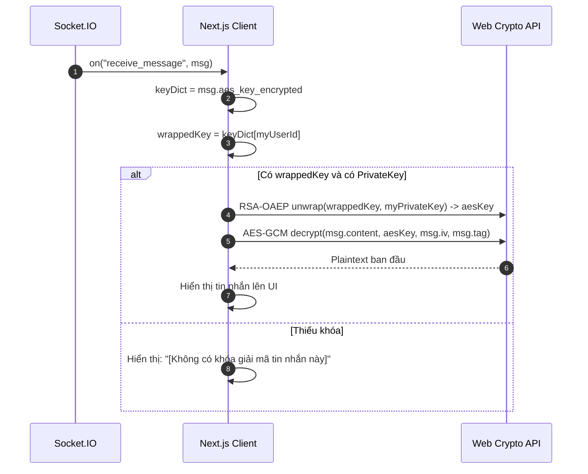

# HỢP ĐỒNG TÍCH HỢP FRONTEND (NEXT.JS + TYPESCRIPT)

**Dự án:** Secure Chat Web (E2EE Messenger)  
**Phiên bản Backend:** NestJS 11 + TypeORM + MySQL 9.5  
**Cơ chế bảo mật:** End-to-End Encryption (AES-256-GCM + RSA-OAEP 2048 + PBKDF2)  

---

## 1. Thông Số Kết Nối & Biến Môi Trường Frontend

Tạo tệp `.env.local` trong thư mục `frontend/`:
```env
NEXT_PUBLIC_API_URL=http://localhost:5000
NEXT_PUBLIC_SOCKET_URL=http://localhost:5001
```

* **REST API Base URL:** `http://localhost:5000`
* **Socket.IO Base URL:** `http://localhost:5001` (WebSocket Transport)

---

## 2. Hệ Thống Kiểu Dữ Liệu TypeScript (TypeScript Definitions)

### 2.1. Đối Tượng Lỗi Chung (Error Contract)
Mọi phản hồi lỗi từ Backend đều tuân theo cấu trúc:
```typescript
export interface ApiErrorResponse {
  msg: string;
}
```

### 2.2. Authentication Types
```typescript
export interface RegisterRequest {
  username: string;          // Bắt buộc, không rỗng
  password: string;          // Bắt buộc, không rỗng
  public_key: string;        // Bắt buộc: SPKI PEM "-----BEGIN PUBLIC KEY-----\n..."
  full_name?: string;
  gender?: 'male' | 'female' | 'other';
  date_of_birth?: string;    // Định dạng YYYY-MM-DD
  avatar_url?: string;
  bio?: string;
}

export interface RegisterResponse {
  msg: string;               // "User created"
  user_id: number;
}

export interface LoginRequest {
  username: string;
  password: string;
}

export interface LoginResponse {
  token: string;             // Chuỗi JWT Bearer
  user_id: number;
}

export interface LogoutResponse {
  msg: string;               // "Logged out"
}
```

### 2.3. User & Profile Types
```typescript
export interface UserProfileResponse {
  user_id: number;
  username: string;
  full_name: string | null;
  gender: 'male' | 'female' | 'other';
  date_of_birth: string | null; // "YYYY-MM-DD"
  avatar_url: string | null;
  bio: string | null;
  status: 'online' | 'offline';
  last_seen: string | null;     // ISO timestamp string
  public_key: string;           // RSA Public Key (PEM)
}

export interface UpdateProfileRequest {
  full_name?: string;
  gender?: 'male' | 'female' | 'other';
  date_of_birth?: string;
  avatar_url?: string;
  bio?: string;
}
```

### 2.4. Chat & Member Types
```typescript
export interface CreateChatRequest {
  name?: string;
  is_group?: boolean;          // Default: false
  members: number[];           // Chat 1-1: đúng 1 ID của đối phương
}

export interface ChatItemResponse {
  chat_id: number;
  name: string;                // Tên nhóm hoặc Full Name/Username của đối phương (1-1)
  is_group: boolean;
  members: number[];           // Danh sách accountId của tất cả thành viên
  created_at: string;          // ISO timestamp
  unread_count: number;        // Số tin nhắn của người khác mà mình chưa đọc
}
```

### 2.5. Message Types (E2EE)
```typescript
export interface SendMessageRequest {
  content: string;             // Base64 của AES-256-GCM ciphertext
  aes_key_encrypted: Record<string, string>; // { [accountId: string]: Base64(RSA_OAEP(aes_key)) }
  iv: string;                  // Base64 của 16 bytes Nonce/IV
  tag: string;                 // Base64 của 16 bytes Auth Tag
}

export interface SendMessageResponse {
  msg: string;                 // "Sent"
  message_id: number;
}

export interface MessageItemResponse {
  id: number;
  sender_id: number;
  content: string;             // Base64 của AES-256-GCM ciphertext
  aes_key_encrypted: string | Record<string, string>; // Cần parse nếu là string
  iv: string;                  // Base64 của 16 bytes Nonce/IV
  tag: string;                 // Base64 của 16 bytes Auth Tag
  timestamp: string;           // ISO timestamp
  recipients: number[];
}
```

### 2.6. Local Encrypted Private Key File Structure
Định dạng file lưu trữ khóa bảo mật tương thích với file `keys/{username}_private.enc.json` cũ:
```typescript
export interface EncryptedPrivateKeyFile {
  ciphertext: string;          // Base64 của Private Key PEM sau khi mã hóa AES-256-GCM
  iv: string;                  // Base64 của 16 bytes IV
  tag: string;                 // Base64 của 16 bytes Tag
  salt: string;                // Base64 của 16 bytes PBKDF2 Salt
}
```

---

## 3. Đặc Tả Endpoint REST API Chi Tiết

| Chức năng | Method & Path | Headers | Body / Params | Status thành công | Status lỗi thường gặp |
| :--- | :--- | :--- | :--- | :--- | :--- |
| **Đăng ký** | `POST /auth/register` | None | `RegisterRequest` | `201 Created` | `400` (Trùng username hoặc thiếu trường) |
| **Đăng nhập** | `POST /auth/login` | None | `LoginRequest` | `200 OK` | `401` (Sai username hoặc password) |
| **Đăng xuất** | `POST /auth/logout` | `Authorization: Bearer <token>` | None | `200 OK` | `401` (Token không hợp lệ) |
| **Xem hồ sơ của tôi** | `GET /users/me` | `Authorization: Bearer <token>` | None | `200 OK` | `401` |
| **Xem hồ sơ + Public Key** | `GET /users/:id` | `Authorization: Bearer <token>` | Param: `id` | `200 OK` | `404` (User không tồn tại) |
| **Cập nhật hồ sơ** | `PUT /users/me` | `Authorization: Bearer <token>` | `UpdateProfileRequest` | `200 OK` | `400`, `401` |
| **Tạo / Gộp hội thoại** | `POST /chats` | `Authorization: Bearer <token>` | `CreateChatRequest` | `200 OK` (chat cũ)<br>`201 Created` (chat mới) | `400` (Sai số lượng thành viên 1-1) |
| **Danh sách hội thoại** | `GET /chats` | `Authorization: Bearer <token>` | None | `200 OK` | `401` |
| **Chi tiết hội thoại** | `GET /chats/:id` | `Authorization: Bearer <token>` | Param: `id` | `200 OK` | `403` (Không thuộc hội thoại), `404` |
| **Đánh dấu đã đọc** | `POST /chats/:id/mark_read` | `Authorization: Bearer <token>` | Param: `id` | `200 OK` | `401` |
| **Lấy tin nhắn lịch sử** | `GET /chats/:id/messages` | `Authorization: Bearer <token>` | Param: `id` | `200 OK` | `403` (Không thuộc hội thoại), `404` |
| **Gửi tin nhắn (REST)** | `POST /chats/:id/messages` | `Authorization: Bearer <token>` | `SendMessageRequest` | `201 Created` | `400`, `403` |
| **Cập nhật trạng thái** | `POST /status` | `Authorization: Bearer <token>` | `{ status: "online" \| "offline" }` | `200 OK` | `400`, `401` |
| **Kiểm tra trạng thái** | `GET /status/:id` | `Authorization: Bearer <token>` | Param: `id` | `200 OK` | `404` |

---

## 4. Hợp Đồng Realtime Socket.IO

### 4.1. Kết Nối & Xác Thực
```typescript
import { io, Socket } from 'socket.io-client';

export function createChatSocket(token: string): Socket {
  return io(process.env.NEXT_PUBLIC_SOCKET_URL || 'http://localhost:5001', {
    auth: { token },
    transports: ['websocket'],
    reconnection: true,
    reconnectionDelay: 1000,
    reconnectionAttempts: 10,
  });
}
```

### 4.2. Danh Sách Sự Kiện

#### A. Sự kiện Client lắng nghe từ Server:
1. `connect`: Kết nối thành công.
2. `disconnect`: Mất kết nối.
3. `online_users`:
   - Payload: `number[]` (Danh sách các `user_id` đang trực tuyến).
   - UI: Hiển thị chấm xanh/xám trên danh sách chat và danh sách bạn bè trực tuyến.
4. `receive_message`:
   - Payload:
     ```typescript
     {
       id: number;
       chat_id: number;
       sender_id: number;
       content: string;               // Base64 Ciphertext
       aes_key_encrypted: Record<string, string>; // Object mapping
       iv: string;                    // Base64 IV
       tag: string;                   // Base64 Tag
       timestamp: string;             // ISO Date
     }
     ```
   - Xử lý UI:
     - Nếu đang mở `chat_id` này: Tiến hành giải mã ngay và hiển thị tin nhắn vào cửa sổ chat; đồng thời gọi ngầm `POST /chats/:id/mark_read`.
     - Nếu đang ở chat khác: Tăng `unread_count` của hội thoại đó lên 1 và đưa hội thoại lên đầu danh sách.
5. `error`:
   - Payload: `{ msg: string }`. Hiển thị Toast thông báo lỗi nếu có.

#### B. Sự kiện Client phát lên Server:
1. `join_chat`:
   - Khi người dùng click chọn mở một hội thoại.
   - Payload: `{ chat_id: number }`.
2. `send_message`:
   - Khi người dùng bấm gửi tin nhắn.
   - Payload:
     ```typescript
     {
       chat_id: number;
       sender_id: number;
       content: string;
       aes_key_encrypted: Record<string, string>;
       iv: string;
       tag: string;
     }
     ```

---

## 5. Quy Trình Mật Mã E2EE Chi Tiết Phía Client (Web Crypto API)

### 5.1. Đăng ký tài khoản mới:


### 5.2. Đăng nhập & Nạp khóa bí mật:


### 5.3. Gửi tin nhắn mã hóa (E2EE):


### 5.4. Nhận và giải mã tin nhắn:


---

## 6. Xử Lý Các Trường Hợp Ngoại Lệ & UI State

1. **Hết hạn Token (Token Expired):**
   - Khi gọi API nhận HTTP `401 Unauthorized`: Xóa token trong `localStorage`, ngắt kết nối Socket.IO, chuyển hướng về trang `/login` kèm thông báo *"Phiên đăng nhập đã hết hạn"*.
2. **Mất kết nối Socket.IO (Reconnection):**
   - Hiển thị thanh thông báo nhỏ trên đầu trang: *"Đang kết nối lại..."*.
   - Khi kết nối lại thành công (`on('connect')`): Gọi lại `GET /chats` để làm mới danh sách tin nhắn và unread count.
3. **Mở trình duyệt mới / Thiết bị mới:**
   - Người dùng đăng nhập được trên máy mới, nhưng sẽ không có Private Key trong `IndexedDB`.
   - UI hiển thị cảnh báo: *"Trình duyệt này chưa có khóa bảo mật. Hãy tải lên file khóa của bạn để giải mã các tin nhắn cũ."* (Cung cấp nút **Nhập khóa** và **Xuất file khóa dự phòng**).
4. **Xử lý tin nhắn rỗng hoặc khoảng trắng:**
   - Nút gửi bị vô hiệu hóa nếu ô nhập chỉ có khoảng trắng.
